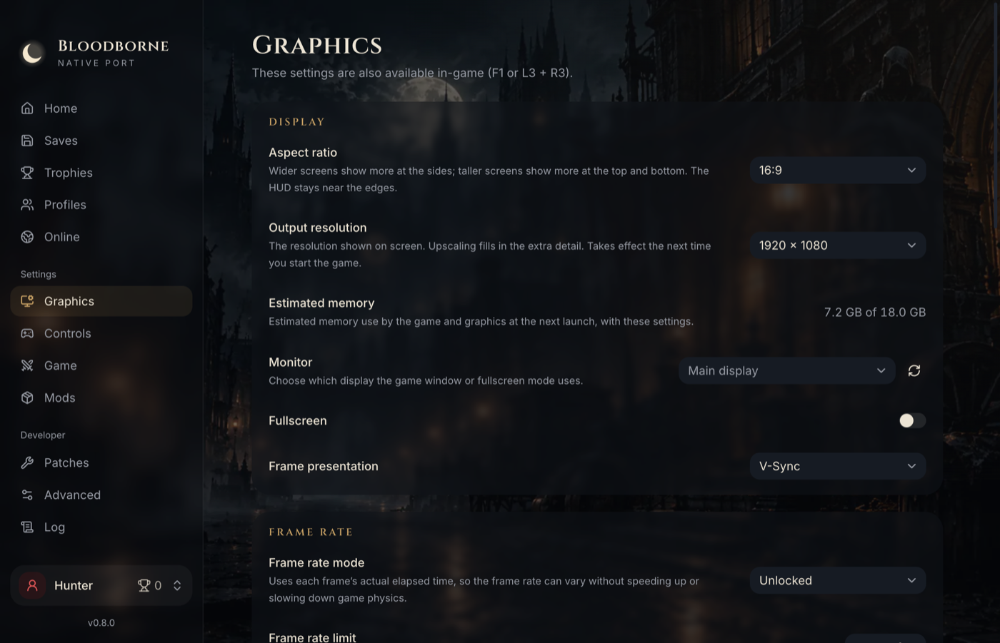

# Settings

[← Documentation](../README.md)

Change settings in the launcher before playing, or in the in-game menu while playing. Both show
the same settings, shared by all profiles, and each shows the other's changes while the game
runs.

## The launcher

| Tab | What it has |
|---|---|
| **Home** | Your profile and trophies, the game folder and edition, a summary of the main settings |
| **Graphics** | Aspect ratio and output resolution with a memory estimate, monitor, fullscreen, V-Sync, frame-rate mode and limit, the FPS counter, upscaling and sharpening, character motion vectors, model detail, visual effects |
| **Controls** | Which controller to use, and button mapping for controller and keyboard |
| **Game** | Game language, skipping the intro videos, your save folder |
| **Profiles** | Profiles, each with its saves, backups and trophies ([Profiles and saves](saves.md)) |
| **Mods**, **Patches** | [Mods and patches](mods-and-patches.md) |
| **Advanced** | Launcher language, hiding the launcher while playing, trophy notifications, update checks, the renderer, experimental performance options, free camera and debug menu, logs, data folders |
| **Log** | The game's output while it runs |

## The in-game menu

Press **F1** on the keyboard, or **L3 + R3** on a controller. The menu has the launcher's
Graphics, Game and Advanced tabs. **L1/R1** switch tabs and **Circle** closes it. Most settings
apply at once; those that need a restart say so, and **Restart** applies them. A controller can
type text (the character's name) on an on-screen keyboard.

## What applies at once

- **Effects** (chromatic aberration, depth of field, motion blur, ambient occlusion, the game's
  own anti-aliasing, shadows from dynamic lights, bloom). Screen-space reflections need a restart.
- **Frame-rate limit.** Above 30 FPS the game steps by each frame's real time, so physics,
  cloth and running speed stay right at any frame rate. **F3** switches a 30 FPS limit on and off
  while playing (useful for Laurence's cinematic, which can misbehave at high frame rates).
- **Fullscreen**, the FPS counter, sharpening and the upscaler's preset with live resolution.

Output resolution, the upscaler preset (with a 1080p output), the renderer and the other
Advanced options apply at the next start.

## Recommended settings

On a Mac the game is limited by the GPU, so the upscaler matters most:

- **Upscaler:** FSR 3.1 with the *Balanced* or *Performance* preset.
- **AMD FSR 4.1.1 (Metal):** AMD's neural upscaler (its Lite model), run on the Mac's GPU. It
  costs more than FSR 3.1: on an M3 Pro at 1080p output (Balanced), 4.8 ms of GPU time a frame,
  about 40 instead of 46 FPS. It suits Macs with frame-rate headroom, or a 30 FPS limit. It needs
  two files of AMD's model from your own copy of AMD's upscaler DLL
  (`amd_fidelityfx_upscaler_dx12.dll` 4.1.1, from OptiScaler or a game): in **Graphics**, *AMD
  FSR 4.1.1 files* → **Choose AMD DLL…**. The option appears in Upscaler only when this Mac can
  run it and the files are there.
- **Character motion vectors:** off by default. They make moving characters much sharper with
  FSR for a few frames per second.
- **Output above 1080p:** use an upscaler preset; the memory estimate (Graphics, and the menu)
  shows what the game will use against your Mac's memory, in amber above three quarters of it.
  Without an upscaler above 1440p, characters are drawn black (a known issue).
- **Renderer** (Advanced → Performance): MoltenVK is the default. **Metal (experimental)** draws
  with Apple's Metal directly and was about 10% faster on an M3 Pro; switch back if anything
  looks wrong.

See [Performance](performance.md).

## Aspect ratio

Graphics → **Aspect ratio**: 16:9 (the game's own) by default, or 4:3, 16:10 (MacBook screens),
21:9, 32:9, or **Auto** (the monitor the game is on). On a wider screen the game shows more to
the sides, on a taller one more above and below; the HUD moves to the screen's edges and the
markers over enemies stay on them. The output resolution then lists that ratio's sizes. A change
applies at the next start.

## The FPS counter

Graphics → Frame rate: on or off, **small** (frame rate and frame time) or **big** (also the
renderer, how the game's code runs, the upscaler, the resolutions and a frame-time graph), in
any corner or edge center. **Metal performance HUD** shows Apple's own statistics.

## While you play

By default the launcher hides to the menu bar while the game runs and comes back when it exits.
Its menu-bar icon has **Show launcher** and **Stop game**. To keep the launcher and its Log tab
visible, turn off Advanced → Launcher → **Hide launcher during gameplay**.

**Trophy notifications** (Advanced → Launcher, on by default) appear in the game's own overlay
when you earn a trophy. The launcher still records trophies when notifications are off.

## Languages

The launcher and the in-game menu come in the 20 languages of the PS4 game: English, Português
(Brasil), Português (Portugal), Español (España), Español (Latinoamérica), Français, Deutsch,
Italiano, Nederlands, Polski, Русский, Türkçe, Suomi, Svenska, Dansk, Norsk, 日本語, 한국어,
简体中文 and 繁體中文.

- **Launcher language:** Advanced → Launcher language (follows macOS by default). The menu
  follows it.
- **Game language** (the game's text and voices): Game → Language.

## Controllers, keyboard and mouse

PlayStation, Xbox and other common controllers work through SDL3. The keyboard and mouse follow
Dark Souls III's PC layout: **WASD** move, **Space** dodge, **Left Shift** run (Shift + Space
jumps), **F**/**Enter** interact, **left click** attack, **Shift + left click** strong attack,
**right click** shoot, **Q** blood vial, **E** transform the weapon, **Tab**/**R** quick item,
**1**/**2** left/right weapon, **3**/**4** d-pad up/down, **C** lock-on, **Escape** menu (and back
inside menus), **G** gestures. Click into the window to give it the mouse; **F1** releases it.

The mouse turns the camera directly (no stick dead zone or speed limit), and points and clicks
in the game's menus: hover selects, left click confirms, right click goes back, the wheel
scrolls. Every key can be remapped on the **Controls** tab.
